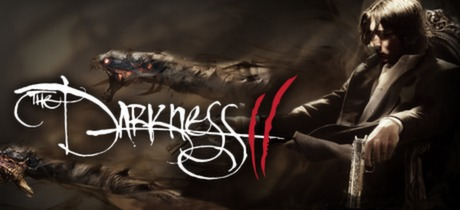

**The Darkness II is the stylish FPS sequel where mob boss Jackie Estacado uses the alien Darkness entity's demonic arms to simultaneously quad-wield weapons and brutally dismember enemies. Features a unique dark powers system and a story involving Jackie's grief.**

---

## 📖 About

The Darkness II is the stylish FPS sequel where mob boss Jackie Estacado uses the alien Darkness entity's demonic arms to simultaneously quad-wield weapons and brutally dismember enemies. Features a unique dark powers system and a story involving Jackie's grief.

## ⚠️ Problems Without Trainer

| Problem | Status |
|---------|--------|
| **Darkness Exposure** — Cannot use Darkness powers in lit areas; light kills Jackie rapidly | ✅ Solved |
| **Vendetta Co-op** — Some co-op mode content requires finding online partners to access | ✅ Solved |
| **Channeling Skill Grind** — Upgrading all Darkness abilities requires extensive Essence collection | ✅ Solved |
| **Difficulty Spikes** — Brotherhoods with Holy weapons in later levels are very lethal | ✅ Solved |

## ✅ Solution

The **The Darkness II Trainer** solves all these issues by giving you complete control over the game.

## 🎯 Full Feature List

- Unlimited Resources
- God Mode / Invincibility
- Instant Skill Cooldown
- One-Hit Kill
- Freeze Game Timer
- Unlock All Items & Achievements
- Custom Speed Multiplier
- Save State Anywhere

## 🚀 Quick Start

1. **Disable Windows Defender** temporarily (trainer may trigger false positive)
2. Download the trainer from the button above
3. Launch The Darkness II
4. Run the trainer as Administrator
5. Activate desired cheats with hotkeys

## 💎 Free vs Paid

| Feature | Free | Pro |
|---------|------|-----|
| Basic God Mode | ✅ | ✅ |
| Unlimited Resources | ✅ | ✅ |
| All Advanced Cheats | ❌ | ✅ |
| Auto-Updates | ❌ | ✅ |
| Priority Support | ❌ | ✅ |

## 💻 Requirements

- Windows 10/11 (64-bit)
- The Darkness II (any version)
- .NET Framework 4.8+
- DirectX 11+

## 🍎 macOS

macOS users can use our alternative tool:

## ⚖️ Legal

This trainer is for educational and single-player use only. Use responsibly.

---

